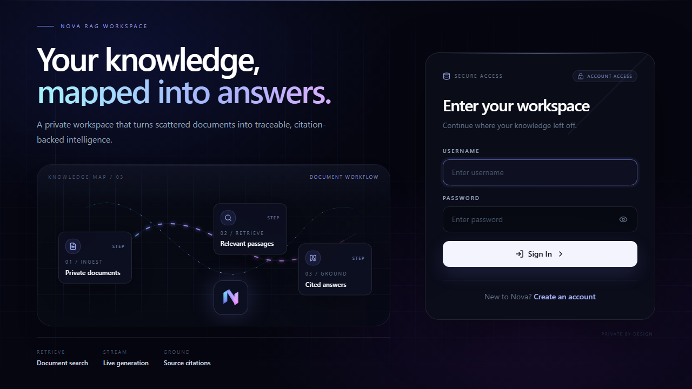
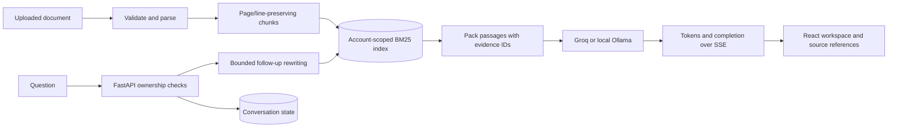

<h1 align="center">Nova RAG Workspace</h1>

<p align="center">
  Ask questions about your documents and inspect the passages behind each answer.
</p>

<p align="center">
  <a href="backend/requirements.txt"></a>
  <a href="backend/README.md"></a>
  <a href="https://github.com/Thazg/NovaRAGChatBot/actions/workflows/ci.yml"></a>
  <a href="LICENSE"></a>
</p>

<p align="center">
  <a href="https://novachatbot.vercel.app/">Live demo</a> &nbsp;|&nbsp;
  <a href="#measured-results">Results</a> &nbsp;|&nbsp;
  <a href="#how-it-works">Architecture</a> &nbsp;|&nbsp;
  <a href="docs/REPRODUCIBILITY.md">Reproduce</a>
</p>



*Actual login UI captured by Playwright on Windows. This illustrates the entry screen, not model output or live-service availability. [Capture context](docs/assets/README.md).*

## Project highlights

Documents are useful only if a reader can find the right evidence and check the answer. Nova implements the ingestion-to-answer path, including the failures between those steps.

| Engineering choice | What is implemented | Evidence |
| --- | --- | --- |
| Traceable document QA | Validated uploads, account-scoped indexes, streamed answers and plain filename/page/extracted-line sources; original-file download | [RAG pipeline](docs/RAG_PIPELINE.md), [API contracts](docs/API_REFERENCE.md) |
| Evaluation follows the product | The benchmark calls the same PDF parser, chunker, retriever and context packer as document QA; reports include parser versions and a corpus fingerprint | [Recorded results](backend/evaluation/results.json), [reproduction](docs/REPRODUCIBILITY.md) |
| Explicit failure contracts | Interrupted streams retain partial output; incompatible embedding identities fall back to BM25; deletion barriers prevent late work from restoring account data | [AI engineering decisions](docs/AI_ENGINEERING.md), [backend tests](backend/tests) |

The application uses React/TypeScript, FastAPI and BM25 by default. FAISS/RRF retrieval and PostgreSQL/Redis/RQ/B2 adapters are optional configurations, with separate verification requirements.

## Live demo

[Open the hosted workspace](https://novachatbot.vercel.app/) or inspect the [hosted API documentation](https://novaaiagent-4.onrender.com/docs). Create an account, upload a document, then ask a question and inspect its source locations. Chat sends selected passages to the configured model provider; use non-sensitive sample documents when evaluating the hosted service.

The frontend is hosted on Vercel and the API on Render, which can require a cold start. This is an application demo, not a replay of benchmark answers. **Observed on 2026-10-26:** BM25, Groq `openai/gpt-oss-20b`, JSON persistence, process-local limits and local indexing threads; health/readiness returned 200. Its reported 6,000-character context budget differs from the benchmark configuration below. A version label does not establish Git-revision parity, and connectivity does not measure answer quality. See [deployment diagnostics](docs/OPERATIONS.md#hosted-demo-and-deployment-diagnostics).

## Measured results

**Recorded on 2026-10-26:** K=5, 10 checksum-pinned arXiv PDFs, 160 pages, 555 chunks, and 100 annotated questions: 90 answerable and 10 unanswerable. Extraction uses pypdf 6.21.2 with font decoding; chunks contain 220 words with 40-word overlap. Independent human annotation review is pending.

All rows below come from the **same saved offline report**. The lexical comparison is the evaluator's candidate/filtering ablation; TF-IDF vectors are a deterministic proxy, not neural embeddings.

| Retrieval path | Page Hit@5, answerable questions | MRR@5, 90 questions | Warm retrieval P50 / P95, 100 queries |
| --- | ---: | ---: | ---: |
| **Production BM25** | **75/90 (83.33%)** | 0.5541 | **5.80 / 10.19 ms** |
| Lexical candidate/filtering ablation | 73/90 (81.11%) | 0.5646 | 6.32 / 10.94 ms |
| TF-IDF + FAISS proxy | 68/90 (75.56%) | 0.5681 | 18.11 / 30.03 ms |
| BM25 + TF-IDF RRF proxy | 73/90 (81.11%) | **0.5837** | 24.61 / 41.81 ms |

Source: [per-query results and configuration](backend/evaluation/results.json), [metric definitions and historical neural experiments](backend/evaluation/README.md). The production path has the highest Hit@5 in this comparison, while RRF has higher MRR; BM25 remains the simpler default. This does not establish superiority on other document collections.

Latency was measured in a local Linux/Python 3.12.15 container with a warm store and no query cache. The report does not capture a complete hardware/utilization manifest, so these timings are diagnostics rather than a portable performance claim. They exclude context packing, HTTP, storage synchronization and model generation. **They are not inference latency, end-to-end chat latency or production performance.**

Two further results matter:

- **Evidence retention: 57/57 retrieved annotated spans survive packing.** Only 57 of the 90 answerable questions had their annotated span retrieved; this conditional result does not count the other 33 as correct. Matching ignores case/whitespace and is not semantic entailment.
- **Unanswerable retrieval: 0/10 correct abstentions.** There is no calibrated refusal threshold. A two-question local Ollama smoke verifies integration only; generated-answer factuality has not been established by a human-reviewed benchmark.

## How it works



Local mode uses JSON state and an in-process indexing executor. Shared deployment adapters add PostgreSQL, Redis/RQ and B2; they require explicit provisioning, migration and staging. Hybrid retrieval is opt-in. See [architecture](docs/ARCHITECTURE.md) for ownership boundaries and [the AI engineering guide](docs/AI_ENGINEERING.md) for model/index changes and experiment design.

## Quick start

Use **Python 3.12** and **Node.js 22.12+**. The example below uses local Ollama so an API key is not required. Model download and CPU/GPU resources are still needed. A [Groq configuration](docs/CONFIGURATION.md) is also supported.

Clone the repository and prepare the backend from its root:

```bash
git clone https://github.com/Thazg/NovaRAGChatBot.git
cd NovaRAGChatBot
python -m venv .venv
source .venv/bin/activate
# PowerShell instead: .\.venv\Scripts\Activate.ps1
python -m pip install --upgrade pip
python -m pip install -r backend/requirements.txt
cp .env.example backend/.env
```

On PowerShell, use `Copy-Item` instead of `cp`. In `backend/.env`, set:

```env
LLM_PROVIDER=ollama
MODEL_NAME=qwen3:4b-instruct
OLLAMA_URL=http://127.0.0.1:11434
RETRIEVAL_MODE=bm25
JWT_SECRET=replace_with_a_unique_random_secret
```

Replace `JWT_SECRET` with a fresh value from `python -c "import secrets; print(secrets.token_urlsafe(48))"`. Keep the real environment file local.

Install the frontend dependencies once, from the repository root:

```bash
cd frontend
npm ci
cp .env.example .env
cd ..
```

After this one-time setup, **start everything with one command** from the repository root:

```bash
python scripts/dev.py
```

On Windows, you can instead **double-click [`start-local.cmd`](start-local.cmd)** or run `.\start-local.cmd`. Virtual-environment activation is unnecessary: the launcher selects the repository's `.venv` interpreter. Install Ollama first when using the local provider. If the configured model is missing, run `python scripts/dev.py --pull-model` once to explicitly allow its download (potentially several GB).

The launcher reads the existing backend settings, starts or reuses Ollama, verifies that the configured model is installed, waits for backend/provider readiness, then starts Vite and opens [127.0.0.1:5173](http://127.0.0.1:5173). Groq mode needs its key but no local model server. Logs share one terminal; **Ctrl+C stops only service trees started by that launcher**, including reload workers. A pre-existing Ollama server remains running. Occupied backend/frontend ports produce an error instead of stopping another application or silently selecting a different port.

Use `--no-browser` to suppress the browser, `--reload` for backend source reload, or `--backend-port 8001 --frontend-port 5174` for different ports; the launcher aligns the frontend API URL and allowed origin automatically. Restart it after changing backend configuration. The launcher is for the development profile with in-process indexing; it does not provision PostgreSQL, Redis/RQ, B2, embedding servers or other shared infrastructure. See the [local launcher guide](docs/CONFIGURATION.md#one-command-local-launcher).

Register a local account and upload a small text/PDF document. [Local API docs](http://127.0.0.1:8000/docs) and [readiness](http://127.0.0.1:8000/health/ready?refresh=true) help diagnose setup. Full environment and Docker instructions are in the [configuration reference](docs/CONFIGURATION.md) and [operations guide](docs/OPERATIONS.md).

## Testing and reproduction

[Reproduce the recorded benchmark and all offline gates](docs/REPRODUCIBILITY.md) from a clean checkout. That recipe rebuilds the ignored corpus from checksummed PDFs before running the full backend suite; no chat provider or paid evaluation is needed.

After the corpus and development dependencies are prepared, the main checks are:

```bash
python -m pytest --cov --cov-report=term-missing --cov-fail-under=64
python -m unittest discover -s scripts -p "test_*.py"
python scripts/check_docs.py
cd frontend
npm run check
npm run test
npm run e2e
```

[GitHub Actions](https://github.com/Thazg/NovaRAGChatBot/actions/workflows/ci.yml) checks documentation, installed Python dependencies, backend coverage/retrieval gates, frontend dependencies/build/unit tests and Chromium E2E. The CI badge reports the latest workflow status on `main`; inspect the linked runs for per-commit evidence. Browser tests use controlled API fixtures, not a model-quality judge. Linux visual baselines use the pinned Playwright image. See [testing scopes](docs/TESTING.md).

## Limitations

- **Evaluation:** one project-specific, English research-paper corpus; independent annotation review is pending. No calibrated abstention or human-validated generated-answer/citation-entailment score exists.
- **Documents:** extracted page/line locations are not a PDF viewer's visual line numbers. OCR, robust table understanding, exact tokenizer budgets and parser process isolation are not implemented.
- **Security:** prompt boundaries and valid evidence IDs do not eliminate prompt injection or prove factuality. Selected context goes to the chosen model provider; hybrid mode also sends text to its embedding endpoint.
- **Operations:** JSON mode supports one process. Real PostgreSQL/Redis/RQ/B2 multi-host staging and restore drills remain unverified. Cross-replica preferences, renewable leases, snapshot GC and durable cleanup reconciliation remain gaps.

## Documentation, contributing and license

Start with the [documentation index](docs/README.md), [API reference](docs/API_REFERENCE.md), [RAG pipeline](docs/RAG_PIPELINE.md) and [AI engineering guide](docs/AI_ENGINEERING.md). Use [CONTRIBUTING.md](CONTRIBUTING.md) for changes and [SECURITY.md](SECURITY.md) for sensitive reports.

Project code is licensed under [MIT](LICENSE). Third-party papers, excerpts, dependencies and marks retain their own terms; see [third-party notices](THIRD_PARTY_NOTICES.md). Maintained by [Nguyen Tam Thang](https://github.com/Thazg).
