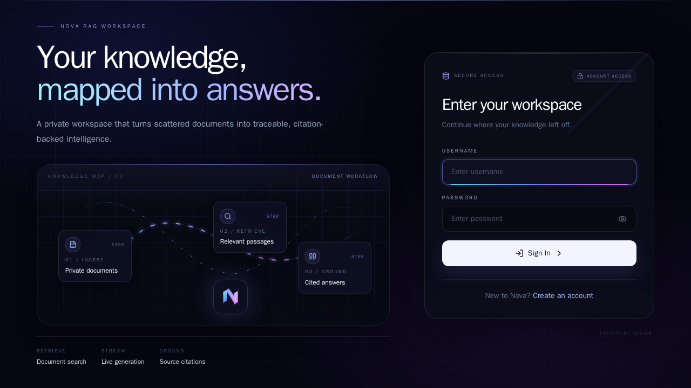
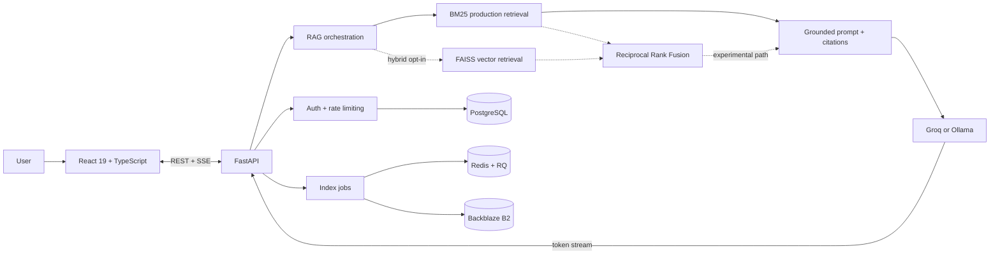

<div align="center">


# Nova RAG Workspace

**A full-stack retrieval-augmented generation system for private document ingestion, evidence retrieval, and citation-backed answers.**

[](https://novachatbot.vercel.app/)
[](https://github.com/Thazg/NovaRAGChatBot/actions/workflows/ci.yml)
[](backend/requirements.txt)
[](frontend/package.json)

[Web application](https://novachatbot.vercel.app/) · [API reference](https://novaaiagent-4.onrender.com/docs) · [CI runs](https://github.com/Thazg/NovaRAGChatBot/actions/workflows/ci.yml) · [Evaluation report](backend/evaluation/README.md) · [Security architecture](docs/SESSION_SECURITY.md)

</div>



## Project overview

Nova implements the complete private-document RAG lifecycle: validated ingestion, document parsing, chunking, benchmark-selected BM25 retrieval, prompt grounding, cited generation, token streaming, evaluation, and persistent infrastructure.

| Capability | Implementation evidence |
|---|---|
| **Grounded, inspectable answers** | Structured evidence with filename, page and extracted line references; retrieval abstention remains a known limitation |
| **Measured retrieval quality** | The shared production BM25 path is checked against a versioned regression corpus; see the [evaluation report](backend/evaluation/README.md) for results and measurement scope |
| **Auditable provenance** | Pinned paper versions, SHA-256 locks, page evidence, reference answers, and per-query results |
| **Configurable infrastructure** | Local JSON/thread mode; optional PostgreSQL, Redis/RQ and B2 adapters, readiness probes, rate limits, Docker and CI |
| **Automated verification** | Backend regression tests, deterministic evaluation gates, and Chromium end-to-end coverage |

> The benchmark is project-specific and designed for regression testing. It also exposes a real limitation: the current retriever scores **0% on 10 unanswerable questions** because abstention is not yet calibrated.

## Documentation

Start with the [documentation index](docs/README.md). The project includes a [configuration reference](docs/CONFIGURATION.md), [architecture](docs/ARCHITECTURE.md), [API/SSE contracts](docs/API_REFERENCE.md), [user guide](docs/USER_GUIDE.md), [RAG pipeline](docs/RAG_PIPELINE.md), [testing guide](docs/TESTING.md), and [operations/recovery guide](docs/OPERATIONS.md).

For code changes, use the [contribution guide](CONTRIBUTING.md); report sensitive findings through the [security policy](SECURITY.md).

The [AI engineering guide](docs/AI_ENGINEERING.md) maps retrieval/model changes to reproducible experiments, failure-path tests and explicit quality limits.

## Key engineering decisions

- **End-to-end system design** — The repository integrates the React client, FastAPI services, retrieval pipeline, security controls, persistence, deployment, and automated verification.
- **Retrieval is benchmark-selected** — BM25 is the production default because it delivers the strongest quality/latency trade-off; dense, RRF, reranking, and multi-query remain reproducible evaluation paths rather than unmeasured complexity in every request.
- **Incremental response delivery** — Server-Sent Events carry tokens and structured evidence. An incomplete stream is marked interrupted; explicit regeneration reuses the user turn instead of automatically replaying POST requests.
- **User-level data isolation** — Uploads, indexes, conversations, preferences, and storage keys are namespaced by authenticated user ID.
- **Explicit failure handling** — Upload quarantine, SSRF defenses, rotating refresh sessions, health/readiness separation, shared rate limiting, and background job status are implemented as first-class flows. Retrieval abstention remains an identified limitation.
- **Reproducible verification** — [GitHub Actions](.github/workflows/ci.yml) runs documentation, backend, frontend and browser checks on pull requests and pushes to `main`. See [Continuous integration](#continuous-integration) for scope and authoritative results.

## Hosted deployment

The application implements the following workflow. The hosted service may run an earlier revision; verify its configuration as described under [Deployment](#deployment).

1. Create a private workspace.
2. Upload a PDF, DOCX, Markdown, RST, TXT, Python file, or Jupyter Notebook.
3. Ask a document-specific question and watch the response stream in real time.
4. Inspect the cited evidence, continue the conversation, or search across prior chats.

**Web application:** [novachatbot.vercel.app](https://novachatbot.vercel.app/)

**OpenAPI documentation:** [novaaiagent-4.onrender.com/docs](https://novaaiagent-4.onrender.com/docs)

> The Render instance may require a cold start after an idle period.

## System architecture

The diagram shows the supported distributed configuration. The hosted demo configuration last observed is documented separately under Deployment.



### Request lifecycle

```text
Upload
  → quarantine and validate
  → parse and normalize
  → create overlapping chunks
  → build a user-isolated index
  → retrieve and rank evidence with production-default BM25
  → construct a grounded prompt
  → stream a cited answer over SSE
```

## Technical implementation

| Area | Implementation | Engineering rationale |
|---|---|---|
| Retrieval | Production-default BM25 with acronym-aware expansion; opt-in FAISS/RRF experiments | Measured through the shared production retrieval function; neural methods remain historical candidate experiments |
| Grounding | Page-preserving context, evidence IDs and plain file/page/line source references | Keeps answers traceable and bounds prompt growth |
| Streaming | SSE token and action events, abort support, regeneration | Responsive UX without unnecessary WebSocket complexity |
| Authentication | PBKDF2 password hashing, short-lived access tokens, rotating refresh tokens | Limits credential exposure and supports session revocation |
| Persistence | PostgreSQL for relational state, B2 for artifacts, local fallback for development | Adapter support; the hosted demo was last observed in local fallback mode (see below) |
| Background work | Redis + RQ indexing jobs with progress endpoints | Optional distributed mode with immutable index revisions and per-user mutation locks |
| Operations | Liveness/readiness probes, request IDs, timing headers, optional Sentry | Makes failure diagnosis and rollout checks observable |
| Frontend | React 19, Zustand, Tailwind, shadcn/ui, Framer Motion | Responsive interaction model with accessible motion controls |

## Evaluation and quality assurance

The regression gate calls the **same PDF parser, chunker and retrieval function as the application**: `load_pdf` → `split_documents` → `retrieve_from_store`. The recorded 2026-10-26 configuration uses **K = 5**, 10 pinned PDFs, 160 pages, 555 chunks (220 words, 40-word overlap), and 100 annotated questions (90 answerable + 10 unanswerable; independent human review pending). Parser versions and the corpus fingerprint accompany the report.

The [evaluation report](backend/evaluation/README.md) describes the current measurements, corpus hash, timing scope, context-retention checks and limitations. [Machine-readable results](backend/evaluation/results.json) contain per-query evidence. These retrieval and packing measurements do not establish generated-answer accuracy or end-to-end chat latency.

The separate [retrieval strategy analysis](backend/evaluation/RETRIEVAL_METHODS.md) records the historical neural-candidate comparison that informed the BM25 default. Its timings come from a different benchmark scope. Independent second-reviewer annotation and calibrated abstention remain open work.

### Continuous integration

CI is implemented in [`.github/workflows/ci.yml`](.github/workflows/ci.yml), triggered by pull requests and pushes to `main`:

| Job | Checks |
|---|---|
| Documentation | Checker fixtures, local links, backend-setting reference coverage and API route/reference consistency |
| Backend tests | Audit installed Python dependencies, rebuild the checksum-pinned corpus, run pytest with the configured coverage floor, then run retrieval evaluation |
| Frontend quality | Install locked dependencies, audit production dependencies, lint/typecheck/build, run unit tests and Chromium E2E |

The workflow is the source of truth for triggers, toolchain versions, commands and thresholds. [GitHub Actions runs](https://github.com/Thazg/NovaRAGChatBot/actions/workflows/ci.yml) show the result for each commit; the header's CI badge links to those runs and does not store a pass/fail claim or assume repository visibility.

The checks exercise deterministic fixtures and isolated adapters. They do not deploy the app, call paid LLM providers or certify a multi-host PostgreSQL/Redis/B2 deployment. See [testing and verification](docs/TESTING.md) for coverage and limits.

### Verification commands

Run each block from the **repository root**, with the Python virtual environment active. On a clean checkout, build the corpus before running the full backend suite:

```bash
python -m pip install --upgrade pip
python -m pip install -r backend/requirements-dev.txt
python -m pip_audit
cd backend
python evaluation/arxiv_corpus/download_papers.py
python evaluation/arxiv_corpus/extract_corpus.py
python evaluation/arxiv_corpus/build_dataset.py
python -m evaluation.run --k 5
cd ..
python -m pytest --cov --cov-report=term-missing
python scripts/check_docs.py
```

```bash
cd frontend
npm ci
npx playwright install chromium
npm audit --omit=dev --audit-level=high
npm run check
npm run test
npm run e2e
```

CI additionally enforces its workflow-defined coverage floor and runs frontend checks inside a pinned Playwright Linux image so browser/system fonts match the reviewed snapshots. Full setup, focused tests and optional provider/neural evaluations are documented in [the testing guide](docs/TESTING.md) and [evaluation guide](backend/evaluation/README.md).

## Security controls

Nova treats private-document RAG as a security-sensitive system.

- Passwords use salted **PBKDF2-HMAC-SHA256 with 310,000 iterations** and constant-time verification.
- Access tokens live only in JavaScript memory; rotating refresh tokens use a `Secure`, `HttpOnly`, `SameSite=Strict` host-only cookie in production, while only token hashes are stored server-side.
- Uploads are quarantined, size-bounded, checked by extension, MIME, signature, and parser, optionally scanned by ClamAV, then stored under server-generated UUIDs.
- PDF and DOCX controls reject encrypted or active PDFs, embedded content, unsafe relationships, malformed archives, and decompression bombs.
- Remote document download blocks unsafe schemes and ports, private/reserved IP ranges, DNS rebinding, unsafe redirects, and invalid payload signatures.
- Production refuses weak/default JWT secrets; origin checks protect cookie-backed endpoints; rate limits can be shared across replicas through Redis.
- Documents, conversations, vector indexes, preferences, and artifact keys remain isolated by authenticated user ID.

Related documentation: [session security](docs/SESSION_SECURITY.md) · [upload and SSRF controls](docs/UPLOAD_SECURITY.md) · [production persistence](docs/PRODUCTION_PERSISTENCE.md)

## Technology stack

| Layer | Stack |
|---|---|
| Frontend | React 19, TypeScript 6, Vite 8, Zustand, Tailwind CSS, shadcn/ui, Framer Motion |
| Backend | Python 3.12, FastAPI, Pydantic, HTTPX |
| Retrieval | rank-bm25 production default; optional FAISS, RRF, BGE, and cross-encoder evaluation |
| LLM | Groq cloud API or local Ollama |
| Data | PostgreSQL, SQLAlchemy, Alembic, Redis, RQ, Backblaze B2 |
| Quality | Pytest, Coverage.py, Playwright, axe-core, oxlint, TypeScript |
| Delivery | Docker Compose, Render, Vercel, GitHub Actions, optional Sentry |

## Local development

### Prerequisites

- Python 3.12+
- Node.js 22.12+
- A [Groq API key](https://console.groq.com/) **or** a local [Ollama](https://ollama.com/) model

### 1. Clone and configure

```bash
git clone https://github.com/Thazg/NovaRAGChatBot.git
cd NovaRAGChatBot
cp .env.example backend/.env
cp frontend/.env.example frontend/.env
```

On PowerShell, replace `cp` with `Copy-Item`.

Set at least the following values in `backend/.env`:

```env
LLM_PROVIDER=groq
GROQ_API_KEY=gsk_your_key_here
JWT_SECRET=replace_with_a_random_secret_of_at_least_32_characters
RETRIEVAL_MODE=bm25
```

For a local model, use `LLM_PROVIDER=ollama` and configure `OLLAMA_URL` plus `MODEL_NAME` instead. `RETRIEVAL_MODE=bm25` is the benchmark-selected production default and does not call an embedding provider. The older hybrid path is an explicit experiment: set `RETRIEVAL_MODE=hybrid` and configure an OpenAI-compatible embedding endpoint only when deliberately retesting that trade-off.

### 2. Start the API

```bash
python -m venv .venv

# Windows
.venv\Scripts\activate

# macOS / Linux
source .venv/bin/activate

pip install -r backend/requirements.txt
cd backend
uvicorn app:app --reload --host 127.0.0.1 --port 8000
```

### 3. Start the frontend

In a second terminal:

```bash
cd frontend
npm ci
npm run dev -- --host 127.0.0.1
```

Open [http://127.0.0.1:5173](http://127.0.0.1:5173). Swagger UI is available at [http://127.0.0.1:8000/docs](http://127.0.0.1:8000/docs).

### Docker Compose

```bash
cp .env.example .env
# Add GROQ_API_KEY and a strong JWT_SECRET to .env
docker compose up --build
```

The containerized frontend is served on `http://localhost:3000`; the API is served on `http://localhost:8000`.

## Repository structure

```text
NovaRAGChatBot/
├── backend/
│   ├── api/routes/          # Auth, chat, documents, conversations, health
│   ├── rag/                 # Parsing, chunking, retrieval, prompts, LLM clients
│   ├── services/            # Auth, persistence, storage, jobs, rate limiting
│   ├── evaluation/          # Versioned datasets, metrics, ablations, reports
│   ├── alembic/             # PostgreSQL schema migrations
│   └── tests/               # Unit, API, security, persistence, integration tests
├── frontend/
│   ├── src/components/      # Product UI, chat, onboarding, settings
│   ├── src/services/        # Typed REST and SSE client
│   ├── src/store/           # Zustand application state
│   └── e2e/                 # Deterministic Playwright portfolio flow
├── docs/                    # Architecture, API, configuration, testing and operations
├── .github/workflows/       # CI quality gates
├── docker-compose.yml
└── render.yaml
```

## Architecture decisions

- **Production retrieval:** BM25 is backed by the committed 100-question quality/latency benchmark; neural retrieval remains opt-in until it exceeds that baseline under an agreed latency SLO.
- **Streaming protocol:** SSE matches the one-way token-delivery requirement without introducing bidirectional WebSocket state.
- **Environment-specific persistence:** JSON and in-process fallbacks support local development; PostgreSQL, Redis/RQ, and B2 support shared, multi-replica deployments.
- **Data ownership boundaries:** B2 stores uploads/index artifacts; PostgreSQL owns users, refresh sessions and conversations; Redis/RQ owns indexing jobs. Local demo mode uses JSON and in-process fallbacks.
- **Evaluation scope:** the shared production BM25 path is the primary regression gate, with deterministic proxy ablations reported separately; provider-backed embedding and LLM evaluations remain opt-in because they transfer versioned test data and incur variable cost.

## Deployment

| Surface | Platform | URL |
|---|---|---|
| Web application | Vercel | [novachatbot.vercel.app](https://novachatbot.vercel.app/) |
| FastAPI service | Render | [novaaiagent-4.onrender.com](https://novaaiagent-4.onrender.com) |
| API documentation | Swagger UI | [novaaiagent-4.onrender.com/docs](https://novaaiagent-4.onrender.com/docs) |

Vercel proxies same-origin `/api/*` requests to Render and applies browser security headers. **Last observed hosted configuration (2026-10-16):** JSON persistence, process-local rate limits and a local indexing thread pool. Readiness reported B2 and malware scanning as optional; that signal does not verify whether optional B2 credentials were present. Check `/health` and `/health/ready` for the current configuration.

The repository also supports PostgreSQL, Redis/RQ and B2 when explicitly provisioned. `render.yaml` supplies web-service configuration; it does not create the worker or managed databases. See [the production runbook](docs/PRODUCTION_PERSISTENCE.md) for required migrations, provisioning and verification. These adapter capabilities are distinct from what has been observed on the hosted demo.

Existing indexes require **Reindex** after upgrading to page/line-preserving ingestion. New citations display the uploaded filename, PDF page and extracted line range as plain text. Line numbers are 1-based within each extracted PDF page (or within extracted text for non-PDF files), including blank lines; they are not inferred from LLM output. Existing answers without saved evidence remain readable but cannot acquire locations retroactively.

## Project ownership

Developed and maintained by [Thazg](https://github.com/Thazg) as a portfolio project focused on production RAG, full-stack engineering, security, and measurable AI quality.

## License

This project is licensed under the [MIT License](LICENSE).
