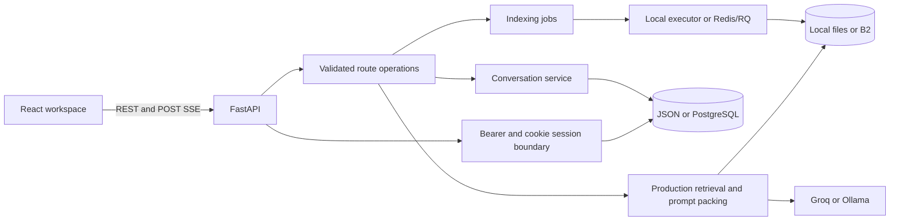
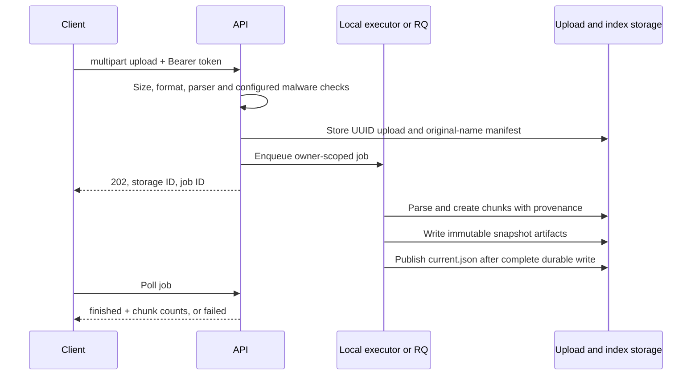

# Architecture and data ownership

This describes repository behavior, not a claim that every optional service is deployed. Source anchors are linked so a contributor can verify a contract before changing it.

## Components

- [`backend/app.py`](../backend/app.py) assembles middleware, lifecycle initialization and route groups. Middleware verifies access tokens, checks account existence and sets `request.state.user_id`.
- [`api/routes`](../backend/api/routes) owns HTTP validation and response semantics. It calls services rather than trusting user-supplied ownership IDs.
- [`services/index_jobs.py`](../backend/services/index_jobs.py) dispatches document work and serializes index mutations per user.
- [`rag/rag_chain.py`](../backend/rag/rag_chain.py) is the production retrieval entry point; [`rag/prompts.py`](../backend/rag/prompts.py) packs context and evidence together.
- [`frontend/src/services/api.ts`](../frontend/src/services/api.ts) is the browser transport boundary; persisted browser preferences do not include conversation data or access tokens.

## Storage matrix

| Data | Local representation | Shared representation | Ownership/consistency boundary |
| --- | --- | --- | --- |
| Accounts/password hashes | `storage/users.json` | PostgreSQL `users` | User UUID; local read/modify/write uses a process lock |
| Refresh sessions | `storage/refresh_sessions.json` | PostgreSQL `refresh_sessions` | SHA-256 token hash, owner UUID, expiry and revocation |
| Conversations | `storage/sessions/<user>/conversations.json` | PostgreSQL `conversations` | Both conversation ID and owner; mutations lock the row in PostgreSQL |
| Preferences | `storage/preferences/<user>.json` | Optional `preferences/<user>.json` B2 copy | Local cache/process lock; not currently a PostgreSQL entity |
| Original documents | `uploads/<user>/<storage-id>` | `uploads/<user>/<storage-id>` in B2 | Server-generated UUID filename; display name is manifest metadata |
| Index snapshots | `storage/index/<user>/revisions/<revision>/` | `index/<user>/revisions/<revision>/` | Immutable artifacts plus checksums; `current.json` publishes a revision |
| Deletion barriers | `storage/index/<user>/deleted_documents.json` | `index/<user>/deleted_documents.json` | Permanent deleted storage IDs; exclude old evidence even if cleanup fails |
| Account cleanup barriers | `storage/account-deletions/<user>.json` | `account-deletions/<user>.json` | UUID-only marker outside removed artifact prefixes; blocks late writes after account cleanup starts |
| Job state | Process-local dictionary | RQ/Redis | Owner stored in job metadata; foreign job IDs return not found |
| Query cache | Bounded process memory | No shared cache | Key includes user, index/deletion revision, retrieval/embedding configuration, query and document scope |

Paths are relative to `backend` unless a setting overrides them. [`services/database.py`](../backend/services/database.py) selects the database adapter at import time. Environment changes require process restarts. PostgreSQL startup in production requires Alembic migrations; local development may create tables automatically.

JSON mode supports a single API process. Local locks and optional B2 backups do not coordinate account/conversation writes across hosts. PostgreSQL and Redis/RQ solve different concerns: configuring one does not configure the other. Preference synchronization across replicas remains a separate limitation.

## Upload and indexing

All index add/delete/reindex operations share a per-user mutation lock: local `RLock` or Redis lease. The RQ timeout is 900 seconds and the Redis lease is 960 seconds. A reused stale store cannot overwrite a newer revision. Failed artifact writes do not publish a partially assembled index.

Dense snapshots additionally record the requested model, hashed endpoint and embedding prefixes. A missing/mismatched profile falls back to BM25 until reindex/update rebuilds aligned vectors. This does not detect a provider silently changing weights under an unchanged identifier. Original-file downloads are authenticated, owner-scoped attachments; bytes are read under the account lock so deferred file opening cannot race account cleanup.

Read-side artifact hydration uses the same ownership barrier/lock so a request started before account cleanup cannot republish its cached snapshot afterward. Nested operations on one thread reuse the outer per-user lock/Redis lease; this is not lease renewal, and the worker timeout still bounds supported work duration.

A successful upload response only acknowledges acceptance. It does not guarantee that parsing/indexing succeeded. Local queued work is not durable across process crashes; distributed mode requires reachable B2 before enqueueing because another host cannot read the API host's ephemeral upload directory.

## Retrieval, evidence and streaming

1. Resolve the current snapshot and deletion set **before** cache lookup. A reader on another host hydrates and verifies immutable artifacts when the revision changes.
2. Retrieve through the configured BM25/default or explicitly enabled hybrid path. Document scope applies before final selection; page/line metadata comes from extraction, not generated prose.
3. Pack evidence and prompt context with the same function and question. A context window's line range covers the included extracted text.
4. Send structured evidence and token events over SSE. The model emits evidence IDs such as `[E1]`; the UI resolves known IDs into plain filename/page/line references.
5. Persist the assistant response and evidence before sending `[DONE]`. A missing terminal marker is incomplete, including a clean network EOF. The client offers explicit regeneration instead of replaying a failed POST automatically.

See [API reference](API_REFERENCE.md) for wire examples and [RAG pipeline](RAG_PIPELINE.md) for parsing/ranking/evaluation detail. PDF line numbers are extracted page-local lines, including blanks; no viewer or clickable document source is required.

## Deletion and migration

Document deletion first persists a barrier, then removes originals/metadata and publishes a cleaned snapshot. If physical cleanup or index publication fails, the old index may remain on disk but its deleted storage ID is excluded from retrieval, summaries, listing and later indexing. Retrying the same DELETE can finish cleanup after the original file has disappeared.

Clear-all keeps barriers and publishes an empty snapshot. Old immutable snapshots are retained for readers; automatic retention/garbage collection is not implemented. Do not equate document deletion with erasure from provider-level backups or logs.

Account deletion has a separate barrier and shares the user mutation lock with active writes and indexing. It removes active document/index/conversation/preference artifacts before deleting credentials. Failed cleanup returns 503 and keeps the account record for an authenticated retry; blocked application writes return 409 with an explicit deletion-pending message. The minimal UUID-only barrier survives cleanup so a delayed job or stream cannot recreate the account's data. Independent backups/log retention are outside that active-data operation.

When switching from local originals to shared storage, an unmatched local file is not proof of deletion. Reindex preserves originals and stops with an explicit migration instruction. The migration CLI verifies existing remote bytes, skips deleted IDs, preserves local copies and fails on conflicts rather than overwriting either copy. The procedure is in [production persistence](PRODUCTION_PERSISTENCE.md).

## Trust and failure boundaries

| Boundary | Guard | Remaining limit |
| --- | --- | --- |
| Browser to private routes | Bearer token + account existence + per-user service predicates | Short-lived access tokens are not a live per-session revocation list |
| Cookie auth POSTs | Trusted `Origin`, host-only HttpOnly cookie, refresh rotation | Cross-tab/session behavior still needs browser and deployment verification |
| Uploaded bytes | Quarantine, byte/parser/archive limits and optional required ClamAV | OCR/image understanding is not provided by the text extraction path |
| Discovered PDF URLs | Scheme/host/IP/redirect and payload validation | Search availability is external; no guarantee that results are useful evidence |
| Stored document text to model | Scoped evidence and citation instructions | Prompt injection and unsupported generated claims are not eliminated by citations |
| Local API to distributed workers | Required durable upload, user lock, checksummed revision publication | Filesystem adapters are not a substitute for real Redis/RQ/B2 staging |

Health liveness describes process/configuration. Readiness probes configured provider and required infrastructure; it is cached briefly and does not exercise an entire generated answer. Request timing headers cover response setup, not total SSE generation latency. Unanswerable retrieval accuracy and independent annotation review remain visible limits in [evaluation documentation](../backend/evaluation/README.md).

## Change boundaries

- Add a route or change validation: update the [API reference](API_REFERENCE.md) and API tests, including auth/ownership/error cases.
- Change storage identity or deletion: test delayed jobs, failed remote writes, retries and a reader with a separate local index directory.
- Change chunks/ranking/context: rebuild the pinned corpus and run production-path evaluation; retrieval Hit@K and evidence retention are separate gates.
- Add a shared relational field: create an Alembic migration and a migration/recovery procedure. A local test database does not prove PostgreSQL row-lock behavior.
- Change session semantics: update backend tests and browser reload/refresh/interruption scenarios together.
