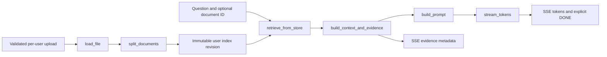

# Retrieval, grounding and evaluation

This guide explains the implementation in `backend/rag/`, its contracts with the chat API and the evidence used to change retrieval behavior. For HTTP payloads, see [API reference](API_REFERENCE.md); for lifecycle and deployment, see [production persistence](PRODUCTION_PERSISTENCE.md).

## Pipeline and ownership



| Responsibility | Implementation | Contract |
| --- | --- | --- |
| Upload validation and user identity | `api/routes/documents.py`, `services/file_security.py` | The parser receives a validated file; stored UUID and original display name remain distinct. |
| Parsing | `rag/load.py` | Produces `Document(text, metadata)`, preserving extracted locations. |
| Chunking | `rag/chunking.py` | 220-word windows with 40-word overlap; locations refer back to extraction, not generated text. |
| Storage and ranking | `rag/vector_store.py` | Documents and optional embedding rows stay aligned; each user has a separate revisioned store. |
| Retrieval policy/cache | `rag/rag_chain.py` | Resolves current index/deletion state before a cached query result; scope is part of the cache key. |
| Context and evidence | `rag/prompts.py` | One deterministic packing function supplies both prompt context and persisted/SSE evidence. |
| Model transport | `rag/llm_client.py` | Groq SSE or Ollama JSON-lines; split UTF-8 and a final unterminated JSON line are handled. Usage-only Groq events are accepted; malformed events/provider failures raise `LLMStreamError`. |
| API stream/session lifecycle | `api/routes/chat.py` | Only explicit `[DONE]` means success; interrupted answers remain incomplete. |

The offline baseline starts at parsing/ranking functions rather than calling a separate approximate implementation. It does not include authentication, HTTP latency, user-history rewriting, B2 synchronization or live generation.

## Parsing and line provenance

Supported types are PDF, DOCX, Markdown, RST, TXT, Python and Jupyter Notebook. Parsing is text extraction, not execution of Python/notebook code. There is no OCR: an image-only PDF may yield no chunks.

- A PDF becomes one `Document` per non-empty extracted page. Page numbers are 1-based.
- Ligatures, whitespace and line-end hyphenation are normalized. `_line_spans` retain the original extracted line numbers, including gaps for blank lines.
- `split_documents` uses word offsets and sorted line intervals to map each chunk back to its lines. Binary search avoids scanning every source line for every word.
- Non-PDF locations refer to the extracted text. DOCX paragraphs and notebook cell sources are joined with blank separators; these line numbers are not physical Word pages or notebook cell IDs.
- `storage_name` identifies the upload; `file_name` is the display name. Two uploads can have the same display name, so API document selection should send the storage ID.

Example persisted chunk:

```json
{
  "content": "A normalized extracted passage...",
  "metadata": {
    "storage_name": "cdbf35a659de4edb844d9e23689b43d9.pdf",
    "file_name": "paper.pdf",
    "page": 2,
    "chunk_index": 1,
    "line_start": 6,
    "line_end": 9,
    "line_spans": [{"line": 6, "start": 0, "end": 33}]
  }
}
```

Line spans use offsets into normalized chunk content; they are not PDF visual coordinates. Legacy indexes without locations remain readable but require reindexing to gain page/line metadata. Old conversation answers cannot acquire evidence retroactively.

## Ranking and document scope

`RETRIEVAL_MODE=bm25` is the default. In that mode, ingestion and queries do not call an embedding provider, even if an embedding endpoint is configured.

1. Expand recognized acronyms and tokenize the query.
2. Score BM25 against the store; when explicitly enabled and present, combine dense FAISS candidates with reciprocal rank fusion (`RRF_K`, default 60).
3. Resolve document scope by storage ID first, then by legacy/display name when no storage ID matches. A different upload's display name cannot widen a selected storage ID. Apply eligibility before fusion ranks, score normalization and the lexical-overlap fallback. Scoped dense queries search beyond the global candidate cap before filtering.
4. If a corpus has no positive BM25/dense scores, use lexical overlap to preserve first-upload/small-corpus retrieval. Punctuation-only documents remain readable/indexable without constructing an invalid zero-token BM25 index.
5. Diversify PDF passages by `(storage_name, page)`, returning at most one chunk per PDF page and at most `K` results. Non-PDF chunks remain separate candidates.

`retrieve_from_store` clamps the production selection to 1–15 passages. Direct `store.retrieve(..., top_k=0)` returns no results. If retrieval returns nothing for a broad overview/summary query, representative passages are selected within the resolved scope; without document scope, they can span the account's indexed documents.

The HTTP chat route uses the shared `rewrite_question` heuristic for referential follow-ups. Only the two most recent different user questions, each capped at 200 characters, can expand a retrieval query. Generated assistant text is never appended to the retrieval query. Standalone short topics and document overview requests remain independent of previous answers. This is a bounded lexical heuristic, not model-based entity resolution; it can still miss or misinterpret a follow-up. Prompt history is separate and remains bounded by `MAX_HISTORY_MESSAGES`.

The returned `_score` is relative to the best eligible fused score. It is **not a calibrated probability**, and the top eligible result is normally 1.0. Do not use it as an absolute answer-confidence threshold. Production currently has no independently calibrated abstention classifier; the 10 absent-claim questions in the regression corpus still expose that gap.

## Optional dense mode

Hybrid mode requires both `RETRIEVAL_MODE=hybrid` and `EMBEDDING_BASE_URL`. It adds provider requests during indexing and queries; BM25 remains the fallback if a usable dense batch cannot be built.

Embedding row `i` must describe document `i`. When adding to an existing lexical-only store after enabling hybrid mode, the writer embeds existing plus new documents together instead of attaching new-only vectors to old rows. A full rebuild may therefore make more provider calls than a normal incremental upload. Partial, non-finite or dimension-incompatible batches are discarded rather than publishing misaligned semantic results. Reindex deliberately when changing the embedding model/dimension.

New snapshots record `embedding_profile`: the requested model ID, a SHA-256 of the endpoint, and document/query prefixes. Credentials and the raw endpoint are excluded. Loading also validates finite two-dimensional arrays and row alignment. A changed profile, or an old snapshot without that profile, disables dense vectors while retaining metadata and BM25. Query-cache keys include the embedding configuration; a cached result cannot bypass a model change. A later successful hybrid update re-embeds existing plus new documents together, or an explicit reindex rebuilds the snapshot.

This profile identifies configured inputs, not provider weight bytes. Silent provider changes behind an unchanged model ID/endpoint cannot be detected automatically; use revisioned model identifiers and operator-managed reindexing. Dense retrieval remains experimental for this corpus; the historical neural comparison is in [retrieval methods](../backend/evaluation/RETRIEVAL_METHODS.md).

## Context packing and plain source references

| Setting | Default | Meaning |
| --- | ---: | --- |
| `TOP_K` | 5 | Requested passages before the 1–15 runtime bound. |
| `MAX_CHUNK_CHARS` | 2400 | Maximum content characters allocated to one passage. |
| `MAX_CONTEXT_CHARS` | 10000 | Combined context budget, including evidence/source headers. |
| `MAX_HISTORY_MESSAGES` | 4 | Recent history entries included in the prompt; each is shortened to 300 characters. |
| `NUM_CTX` | 8192 | Ollama context option, not an exact tokenizer-backed budget. |
| `MAX_TOKENS` | 2048 | Provider output-token request. |

Complete chunks are preferred when they fit. Under smaller limits, packing selects a contiguous query-relevant window and narrows the evidence line range to overlapping extracted spans. IDs (`E1`, `E2`, ...) refer only to passages actually included in the prompt. Changing budgets can change both evidence retention and citation IDs.

The model cites `[E1]`; the application resolves that ID from saved evidence:

```text
The supported claim (Source: paper.pdf, Page 2, Lines 6–9).
```

Sources remain plain text. They do not require an uploaded-file URL, viewer or popup. Copy, Share and conversation TXT export preserve the same filename/page/line values. While streaming, the browser hides source locations and complete/partial `[E#]` markers; before answer text arrives it shows only the thinking indicator. On completion it resolves saved evidence. Structured account JSON retains raw message content and evidence metadata.

The chat prompt requires evidence support, treats retrieved text/history as untrusted data, and distinguishes unsupported information from proof that something does not exist. Before persisting successful completion, the API rejects any reserved `[E#]` reference absent from the packed evidence. The attempt remains interrupted and does not emit `[DONE]`. Missing citations are not automatically rejected, because a valid refusal may cite no passage. Neither valid IDs nor the fallback list of retrieved sources certify claim entailment. Prompt boundaries are defense in depth, not a complete prompt-injection defense.

Character limits are not exact token limits, especially for multilingual text. The configured model provider receives the packed document text, history and instructions. Provider failures flush already-produced buffered text before the error event; partial text is saved with `interrupted:true`, and no completion signal is sent.

The separate document-summary endpoint is not this citation-backed chat path. It selects one storage ID, rejects ambiguous display names, summarizes at most the first 20,000 joined content characters, and returns no evidence IDs. It therefore does not establish complete-document coverage or per-claim provenance; provider errors/empty summaries return 503.

## Revision and deletion invariants

Writers use the per-user mutation lock; local mode supports a single process, while Redis coordinates separate API/worker processes. Each write uploads immutable revision artifacts, verifies their hashes via a manifest, then publishes `current.json`. Readers must not combine artifacts from different revisions.

Deletion barriers are independent of snapshot publication. Readers resolve the current snapshot and deletion set before using a query-cache hit; direct snapshot loading and persistence also exclude deleted storage IDs. Consequently, failed cleanup cannot make a previously marked document searchable again. Queued jobs and full reindex follow the same barrier. See [production persistence](PRODUCTION_PERSISTENCE.md) for retry, migration and retained-snapshot behavior.

Account deletion has a separate monotonic barrier. Snapshot hydration, retriever/query cache access and cache publication share the same per-user lock with cleanup and reject an account marked for deletion. Cleanup waits for an in-flight reader before removing its hydrated files, so a late remote response cannot recreate a private local cache after deletion completes. Nested operations in one thread reuse the lock/Redis lease; cleanup can still unload caches after the barrier is installed. Synthetic race tests exercise this ordering, not a real distributed storage deployment.

## Safe per-account reindex

From `backend`, with the same configuration/storage access as the API:

```bash
python rebuild_index.py --user-id <existing-account-id>
```

The account ID is required and must be a flat, non-anonymous ID for an existing account. The command calls the same guarded per-user rebuild as the API, honoring locks, account/document deletion barriers and migration rules. It has no import-time side effects and does not recursively combine uploads from different accounts.

For local-to-distributed cutover, migrate that account's originals first:

```bash
python -m services.migrate_uploads --user-id <existing-account-id>
python rebuild_index.py --user-id <existing-account-id>
```

Use the full backup/drain/verification sequence in the production runbook. A failed storage read or unmatched local-only original stops publication; it is not interpreted as permission to erase the old index or original file.

## Evaluation layers

| Layer | Command, from `backend` | What it establishes |
| --- | --- | --- |
| Deterministic regression | `python -m evaluation.run --k 5` | Production BM25 page ranking, conditional character-span evidence retention, static annotation citation checks and lexical proxy scores. No provider calls. |
| Generated answers, opt-in | `python -m evaluation.live_answer_eval --limit 10 --k 5` | Production BM25 retrieval/packing/prompt plus the configured LLM. Makes provider requests and can incur cost. |
| Configured embedding experiment, opt-in | `python -m evaluation.live_retrieval_eval --help` | Separate embedding-backed comparison. Requires an embedding provider and is not the production regression gate. |
| Historical neural comparison | `python -m evaluation.advanced_retrieval_eval --help` | Separate neural candidate/reranker experiment; model downloads are explicit. |

Live answer evaluation version 3 retrieves from the whole corpus before consulting reference labels, scores `[E#]` IDs against packed evidence and annotated pages, and retains failed provider attempts in quality denominators. It records dataset/prompt hashes, effective non-secret configuration, partial output on provider failure and first-token/attempt timings. Unknown IDs score as unsupported. Unanswerable responses remain available for human review without an invented automatic accuracy metric. Character-based token/cost estimates are not billing usage, even when partial output is retained.

Offline report version 2 times retrieval separately from packing and annotation comparison. Proxy ablations reuse pre-tokenized corpus data; these timing scopes differ from older reports. Never compare that warm retrieval number directly with full HTTP chat latency.

PDF parser/font-decoder versions accompany rebuilt corpus reports. Annotation and packing matching ignore case and whitespace but preserve every other character; this tolerates extraction spacing changes and can conflate word boundaries. It does not perform fuzzy or semantic matching. A parser upgrade must rebuild the corpus and pass unchanged retrieval floors before acceptance.

The latest deterministic result is [results.json](../backend/evaluation/results.json). See the [evaluation guide](../backend/evaluation/README.md) for corpus construction, thresholds and limitations. No generated-answer report is evidence of quality until the opt-in command has actually run and its outputs have been reviewed.

## Tests and change criteria

From the repository root:

```bash
python -m pytest -q backend/tests/test_rag_chain.py backend/tests/test_retrieval_scope.py backend/tests/test_chunking.py backend/tests/test_context_packing.py
python -m pytest -q backend/tests/test_evaluation.py backend/tests/test_evaluation_contracts.py backend/tests/test_live_evaluation.py backend/tests/test_rebuild_cli.py
python -m pytest -q backend/tests/test_llm_client.py backend/tests/test_index_account_races.py
```

Synthetic regression cases cover scoped BM25/FAISS competition, first-upload fallback, dense-row alignment, punctuation-only input, page/line provenance, packing budgets, timer boundaries, oracle-evidence leakage, provider failures and per-account CLI isolation. Live-evaluator tests mock the provider; they do not spend API credits.

When changing parsing, chunk sizes or ranking, rebuild the checksum-pinned corpus and run all existing gates without lowering them. When adding an abstention rule, create a separate development/calibration set and preserve the current 100 questions as a regression set. Add human-reviewed generated-answer checks and real storage/worker staging before describing the system as production-verified.
